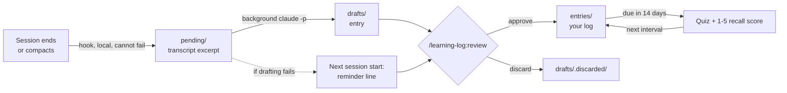

# learning-log

**A Claude Code plugin that keeps a learning journal for you.** Every session's learnings,
decisions and mistakes are captured automatically when the session ends, drafted into a
Markdown entry, approved by you, and quizzed back to you later with spaced review.

No command to remember. If you forget to log, nothing is lost.

```
Learning log: 2 drafts to approve, 1 entry due for review. Run /learning-log:review
```

## Why

Engineering learning logs die in one of two ways:

- **Manual logging** (a `/log` command at the end of a task) breaks the first time you forget.
- **Automatic logging** produces a pile of notes nobody reads again.

learning-log captures automatically, keeps you in the loop with an approval step, and makes
the log useful with a dedicated **Mistakes** section and **spaced-review quizzes**.

## How it works



1. **Capture.** On `SessionEnd` and `PreCompact`, a hook condenses the new part of the
   transcript (your messages, Claude's replies, tool calls, tool errors) into `pending/`.
   It is local file work only, so it cannot fail on auth or network.
2. **Draft.** A detached background `claude -p` call (Sonnet, no tools) turns the excerpt into
   an entry: Learnings, Decisions, Mistakes, Quiz. Trivial sessions become `NOTHING_TO_LOG`.
3. **Remind.** At the next session start you get one line with what is waiting.
   Excerpts that failed to draft are retried in the background.
4. **Review.** `/learning-log:review` goes one item at a time: draft any leftovers, approve,
   edit or discard each draft, then quiz you on entries that are due.

## Example entry

This is a real entry, drafted automatically from the session that built this plugin.
Note the **Mistakes** section: it caught Claude's own mistakes, too.

> ## Mistakes
> - **What happened:** The headless drafting call failed to authenticate while the main
>   session worked fine. **Cause:** The standalone CLI login had expired, and it is separate
>   from the desktop app's login. **Next time:** Test a trivial `claude -p` call first when
>   building anything that spawns a headless Claude.
>
> ## Quiz
> - **Q:** Why does the capture hook only copy the excerpt to `pending/` and leave drafting
>   to a detached worker?

Full entry: [`examples/example-entry.md`](examples/example-entry.md)

## Install

Requirements: Claude Code, Node.js 18+, and the `claude` CLI on your `PATH`, signed in
(`claude auth login`).

In Claude Code:

```
/plugin marketplace add SritejCanchi/learning-log
/plugin install learning-log@learning-log
```

Or from a terminal:

```bash
claude plugin marketplace add SritejCanchi/learning-log
claude plugin install learning-log@learning-log
```

It starts working in your next session.

## Use

| You do | What happens |
|---|---|
| Nothing | Each session is captured and drafted when it ends |
| `/learning-log:review` | Approve drafts one at a time, then get quizzed on due entries |
| `/learning-log:log` | Log the current conversation right now and approve it on the spot |
| Ask "what did I learn about X?" | Claude can search `~/.claude/learning-log/entries/` |

Spaced review: first review 14 days after approval. Then a score of 1-2 brings it back in
3 days, 3 in 14 days, and 4-5 doubles the interval each time (max 180 days).

## Your data

Everything stays in `~/.claude/learning-log/` as plain Markdown:

| Folder | Contains |
|---|---|
| `entries/` | The log: approved entries, one file each |
| `drafts/` | Waiting for approval (`.discarded/` keeps rejected ones) |
| `pending/` | Transcript excerpts not drafted yet |
| `.state/` | Per-session offsets, so nothing is captured twice |
| `.logs/hooks.log` | What the hooks did, including errors |

Privacy: excerpts are stored on your machine. Drafting sends the excerpt to Claude through
your own `claude` CLI, the same as any Claude Code request. Set `LEARNING_LOG_NO_WORKER=1`
to keep capture local-only and draft inside `/learning-log:review` instead.

Headless runs (`claude -p`, Agent SDK scripts, CI) are not logged.

## Settings

Environment variables:

| Variable | Default | Effect |
|---|---|---|
| `LEARNING_LOG_DIR` | `~/.claude/learning-log` | Where the data lives |
| `LEARNING_LOG_MODEL` | `sonnet` | Model for background drafting |
| `LEARNING_LOG_CLAUDE` | `claude` | Command used for background drafting |
| `LEARNING_LOG_NO_WORKER` | unset | Capture only; draft during `/learning-log:review` |
| `LEARNING_LOG_INCLUDE_HEADLESS` | unset | Also log headless `claude -p` sessions |

## Troubleshooting

- **No drafts appear, only "sessions not drafted yet":** background drafting is failing.
  Check `~/.claude/learning-log/.logs/hooks.log`. The usual cause is an expired CLI login:
  run `claude auth login`. Nothing is lost; the excerpts wait in `pending/`.
- **Desktop app users:** the desktop app and the standalone `claude` CLI keep separate logins.
  Sign in the CLI once with `claude auth login`.

## Development

```bash
node tests/smoke-test.mjs
```

The smoke test runs every hook end to end against a synthetic transcript with a fake
`claude`, so it needs no network or login.

The entry format lives in [`ENTRY_FORMAT.md`](ENTRY_FORMAT.md), shared by the background
drafter and both skills.

## Uninstall

```bash
claude plugin uninstall learning-log@learning-log
```

Your log in `~/.claude/learning-log/` is kept.

## License

MIT
